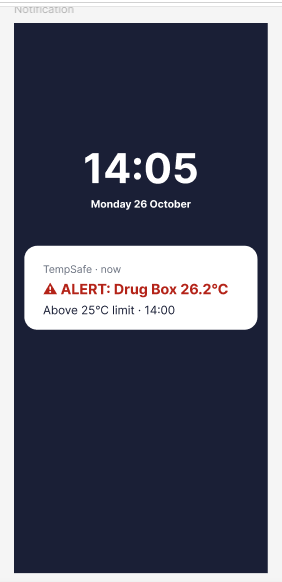
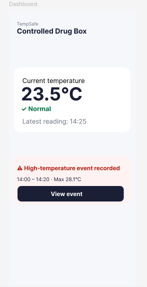
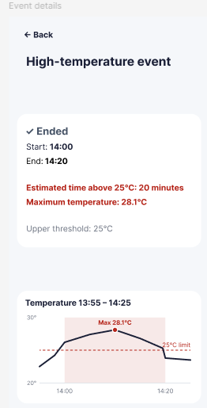

# Core scenario mock-ups (Sprint 5)

These screens follow the [Main Use Case](../requirements/main-use-case.md): Shannon reviews a temperature
excursion after patient care. The values are synthetic demonstration data for user testing.

## Screens

| Screen | Purpose |
|--------|---------|
| 1. Notification | High-temperature Alert at 14:00, short enough to read at a glance. |
| 2. Dashboard | Current status Normal (23.5°C) with a card for the recorded event and a "View event" button. |
| 3. Event details | Ended event: 14:00–14:20, estimated 20 minutes above 25°C, maximum 28.1°C, graph with the 25°C limit. |

| 1. Notification | 2. Dashboard | 3. Event details |
|:---:|:---:|:---:|
|  |  |  |

## Clickable prototype

[Open the TempSafe core scenario prototype in Figma](https://www.figma.com/proto/hrje3LHb2hOaGPuN2FdZjw/TempSafe?node-id=2-4&p=f&t=zW4Zs9EBhVLB5kMp-1&scaling=scale-down&content-scaling=fixed&page-id=0%3A1&starting-point-node-id=2%3A2)

User flow: Notification → Dashboard → **View event** → Event details → **Back** → Dashboard.

## Design decisions

- **Short notification text.** The alert reads "⚠ ALERT: Drug Box 26.2°C / Above 25°C limit · 14:00", so Shannon can
  understand it in one glance while she is treating a patient.
- **Current status and past event are separated.** The dashboard shows that the box is Normal now, while a separate
  card shows that a high-temperature event was recorded earlier.
- **Duration is labelled as estimated.** Readings are taken every 30 seconds, so the exact crossing time is not known.

## Accessibility check before user testing

Guided by Universal Design Principle 4 – Perceptible Information.

- Status is never shown by colour alone: each state uses an icon, a word and a colour (✓ Normal, ⚠ Alert, ✓ Ended).
- Key values (current temperature, maximum, duration) use large, bold text.
- Buttons have text labels and a touch target of at least 44 px ("View event" is 48 px high).
- All three screens in the core scenario were reviewed.

### Colour contrast (WCAG AA, minimum 4.5:1)

| Text | Background | Ratio | Result |
|------|------------|-------|--------|
| Alert red `#B42318` | White `#FFFFFF` | 6.6:1 | Pass |
| Alert red `#B42318` | Light red `#FEF3F2` | 6.1:1 | Pass |
| Normal green `#067647` | White `#FFFFFF` | 5.7:1 | Pass |
| Secondary grey `#6B7280` | White `#FFFFFF` | 4.8:1 | Pass |
| Dark text `#1A1F36` | Light grey `#F5F7FA` | 15.1:1 | Pass |
| White `#FFFFFF` on button | Dark `#1A1F36` | 16.2:1 | Pass |
