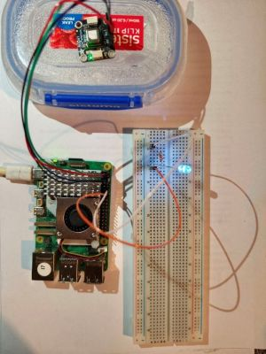

# HW-02 — Single-Colour LED Patterns: Integration Test Report

## 1. Test information

| Item                | Details                                |
|---------------------|----------------------------------------|
| Test ID             | HW-02                                  |
| nitial test date    | 29.10.2026                             |
| ntegration test date| 30.10.2026                             |
| Tested by           | Hanna Bokariuk                         |
| Project             | TempSafe                               |
| Related requirement | FR-06 — Provide a local LED warning    |
| Status              | PASS — LED control integrated with temperature states |

## 2. Objective

Connect a single-colour LED to a Raspberry Pi through a current-limiting resistor and verify the planned patterns:
off, steadily lit, and two short flashes followed by a pause.

Verify that a single-colour LED connected to the Raspberry Pi is automatically controlled using temperature readings from the SCD-41 sensor and the agreed TempSafe prototype temperature profile.

The test also verifies the double-flash pattern used to indicate a sensor error.

## 3. Equipment

- Raspberry Pi.
- White single-colour LED.
- 220 Ω resistor.
- Jumper wires.
- A container with hot water was used to increase the sensor temperature during testing.

## 4. Wiring

| Connection               | Purpose                                             |
|--------------------------|-----------------------------------------------------|
| Physical pin 12 — GPIO18 | Connected through a 220 Ω resistor to the LED anode |
| Physical pin 14 — GND    | Connected to the LED cathode                        |

**Difference from the project wiring diagram:** GPIO18 and a 220 Ω resistor were used instead of GPIO17 and a 1 kΩ
resistor.

## 5. Temperature profile

The prototype currently uses the following temperature thresholds:

Normal: 0°C < T < 24°C → LED OFF
Warning: 24°C ≤ T ≤ 25°C → LED ON
Alert: T ≤ 0°C or T > 25°C → LED ON
Sensor error: double-flash LED pattern

The threshold values are currently stored as local constants on the Raspberry Pi so that LED control can continue without a network connection.

## 6. Software

- Python 3.
- GPIO Zero library.
- Main script: temperature_readings.py on the Raspberry Pi.
- Repository copy: [Python LED test script](../../device/temperature_readings.py).
- Python virtual environment: .venv.
- Editor: Vim.

Run commands:

```bash
cd ~/scd41
source .venv/bin/activate
python temperature_readings.py
```
The script:

1. Reads the temperature from the SCD-41.
2. Determines the current temperature state.
3. Controls the LED using that state.
4. Saves the temperature reading to the local SQLite database.
5. Displays the temperature and state in the terminal.

Example output:
Saved: 2026-10-30T... | 20.93 C | State: Normal

## 7. Test procedure

1. Connected the SCD-41 and LED to the Raspberry Pi.
2. Verified that the LED could be controlled using GPIO18.
3. Added temperature state classification to temperature_readings.py.
4. Connected the temperature state to the LED control logic.
5. Verified Normal operation at room temperature.
6. Placed the SCD-41 near/in contact with a container of hot water to increase the measured temperature.
7. Observed the LED response when the temperature entered Warning and Alert states.
8. Simulated a sensor failure in the Python code.
9. Verified that the LED produced the double-flash sensor-error pattern.
10. Removed the simulated error and confirmed normal sensor operation.

## 8. Results

| Test | Expected result | Observed result | Status |
|---|---|---|---|
| Normal | LED OFF | LED remained off | PASS |
| Warning | LED ON | LED switched on | PASS |
| High-temperature Alert | LED ON | LED remained on | PASS |
| Sensor error | Two short flashes | Double-flash pattern observed | PASS |
| Terminal status | Temperature and state displayed | Temperature and state displayed correctly | PASS |
| Local operation | LED control does not require network access | Processing performed locally on Raspberry Pi | PASS |

For the sensor-error pattern, each flash is programmed for 0.2 seconds with a 0.2-second gap between flashes.

## 9. Evidence



**Figure 1.** SCD-41 temperature sensor placed near a container with hot water to increase the measured temperature and trigger the Warning and Alert states.


**Figure 2.** Raspberry Pi terminal showing the SCD-41 temperature reading and calculated temperature state.


**Figure 3.** Raspberry Pi terminal showing the simulated sensor error used to test the double-flash LED pattern.

## 10. Limitations

The high-temperature Warning and Alert states were tested using a container with hot water to increase the sensor temperature.

The low-temperature Alert condition was not physically reproduced during this test.

The sensor-error state was simulated in the Python code rather than produced by physically disconnecting the sensor.

The temperature thresholds are currently stored locally in the Raspberry Pi script. A future improvement could synchronise the threshold profile from the backend/MySQL database and store a local copy on the Raspberry Pi for offline operation.

## 11. Conclusion

The LED was successfully integrated with the SCD-41 temperature readings.

The Raspberry Pi automatically determines the current temperature state and controls the LED locally. Normal, Warning, high-temperature Alert and sensor-error behaviour were tested successfully.

The integration test provides evidence that FR-06 is functioning as intended.