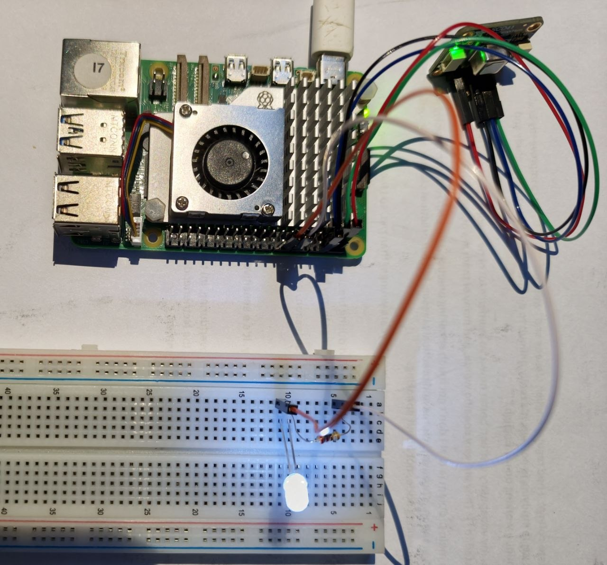

# HW-02 — Single-Colour LED Patterns: Initial Test Report

## 1. Test information

| Item                | Details                                |
|---------------------|----------------------------------------|
| Test ID             | HW-02                                  |
| Test date           | 29.10.2026                             |
| Tested by           | Hanna Bokariuk                         |
| Project             | TempSafe                               |
| Related requirement | FR-06 — Provide a local LED warning    |
| Status              | **PASS — all three patterns observed** |

## 2. Objective

Connect a single-colour LED to a Raspberry Pi through a current-limiting resistor and verify the planned patterns:
off, steadily lit, and two short flashes followed by a pause.

Temperature-triggered LED control is outside the scope of this test.

## 3. Equipment

- Raspberry Pi.
- White single-colour LED.
- 220 Ω resistor.
- Jumper wires.

## 4. Wiring

| Connection               | Purpose                                             |
|--------------------------|-----------------------------------------------------|
| Physical pin 12 — GPIO18 | Connected through a 220 Ω resistor to the LED anode |
| Physical pin 14 — GND    | Connected to the LED cathode                        |

**Difference from the project wiring diagram:** GPIO18 and a 220 Ω resistor were used instead of GPIO17 and a 1 kΩ
resistor.

## 5. Software

- Python 3.
- GPIO Zero library.
- Test script: `led_test.py` on the Raspberry Pi.
- Repository copy: [Python LED test script](../../device/led_test.py).
- Editor: Vim.

Run command:

```bash
python3 led_test.py
```

## 6. Test procedure

1. Connected the LED to the Raspberry Pi through the resistor.
2. Verified that the GPIO Zero library was available.
3. Created `led_test.py` using Vim.
4. Executed the script to demonstrate the three patterns in sequence.
5. Visually checked the LED behaviour.
6. Confirmed that the LED switched off when the test finished.

## 7. Results

| Mode            | Expected result                                            | Observed result                                          | Status |
|-----------------|------------------------------------------------------------|----------------------------------------------------------|--------|
| Normal          | LED remains off for 5 seconds                              | LED remained off                                         | PASS   |
| Warning / Alert | LED remains steadily lit for 5 seconds                     | Steady illumination was observed                         | PASS   |
| Sensor error    | Two short flashes followed by a pause, repeated five times | Five cycles of double flashes with a pause were observed | PASS   |
| Test completion | LED switches off                                           | LED switched off                                         | PASS   |

For the Sensor error pattern, the script sets each flash to 0.2 seconds, the gap between flashes to 0.2 seconds,
and the pause after each pair to 1 second. These are programmed intervals; timing accuracy was not independently
measured.

## 8. Evidence



**Figure 1.** White LED connected to Raspberry Pi GPIO18 through a 220 Ω resistor, steadily lit during the Warning/Alert
test.

## 9. Limitations

The patterns were selected by the test script. No actual temperature excursion or sensor failure was triggered.
Integration with the sensor and main application was not tested.

The planned photograph will show the wiring and steady illumination. The off and flashing results were recorded
through visual observation.

This test provides partial evidence for FR-06; automatic state-driven operation remains to be tested.

## 10. Conclusion

The LED successfully demonstrated all three planned patterns. The basic wiring and software-control test passed.
The next step is to connect the LED behaviour to the states of the main system.
