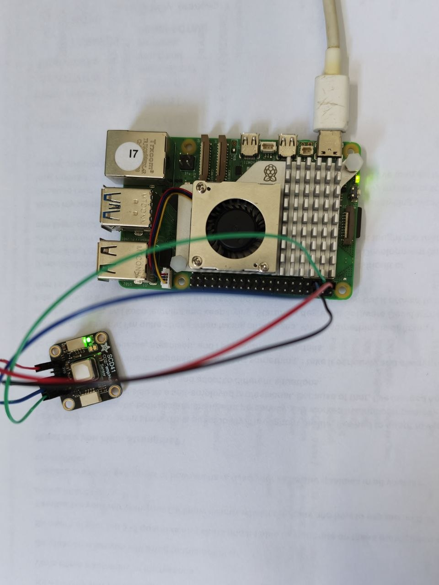

# HW-01 — SCD41 Basic Temperature Readings: Initial Test Report

## 1. Test information

| Item | Details |
|---|---|
| Test ID | HW-01 |
| Test date | 19 October 2026 |
| Tested by | Hanna Bokariuk |
| Project | Smart Box |
| Related requirement | FR-03 — Measure and record internal temperature |
| Status | **PASS — basic functional test** |

## 2. Objective

Verify that the SCD41 sensor communicates with a Raspberry Pi over I²C and that a Python script can collect and record basic temperature readings.

This is an **initial functional test**. It does not validate temperature accuracy against a reference thermometer or the complete Smart Box system.

**Hardware difference:** The project design specifies a Raspberry Pi 400; this initial test used a Raspberry Pi 5.

## 3. Equipment

- Raspberry Pi 5 with microSD card and Raspberry Pi OS (Debian 13, Trixie)
- SCD41 breakout sensor
- Four jumper wires
- Power supply for the Raspberry Pi
- Laptop running VS Code, connected to the Raspberry Pi via SSH

## 4. Wiring and sensor detection

The breakout was wired to the Raspberry Pi's I²C interface as follows:

| Raspberry Pi physical pin | Function | SCD41 breakout pin |
|---|---|---|
| 1 | 3.3 V | VIN |
| 6 | Ground | GND |
| 3 | GPIO2 / SDA | SDA |
| 5 | GPIO3 / SCL | SCL |

The I²C interface was enabled and the sensor responded at **address `0x62`** using `sudo i2cdetect -y 1`.

## 5. Software and test settings

| Item | Actual value |
|---|---|
| Operating system | Debian GNU/Linux 13 (Trixie), Raspberry Pi packages |
| Python | 3.13.5 |
| Sensor library | `adafruit-circuitpython-scd4x` 1.4.13 |
| Sensor interface | I²C (`/dev/i2c-1`, address `0x62`) |
| Sensor operating mode | Periodic measurement |
| Script on Raspberry Pi | `/home/user/scd41/read_scd41.py` |
| Run command | `python read_scd41.py` (in the project's virtual environment) |
| Sampling interval | Approximately 5 seconds |
| Recorded samples | 5 |
| Time zone in CSV | UTC+01:00 (Irish summer time on the test date) |

A five-second reading interval was used for this initial test; the planned application sampling interval is 30 seconds. The script printed the temperature to the terminal and saved the timestamp and temperature to a CSV file.

## 6. Acceptance criteria

The basic functional test passes if:

1. The I²C sensor is detected and the Python sensor object initialises.
2. The script collects multiple temperature readings in °C.
3. Each recorded sample includes a timestamp.
4. No read or communication errors are observed during the recorded run.

## 7. Procedure

1. With Raspberry Pi power disconnected, connect the SCD41 breakout to the I²C pins.
2. Power on the Raspberry Pi and connect to it over SSH.
3. Enable I²C (`dtparam=i2c_arm=on`) and verify that `/dev/i2c-1` exists.
4. Confirm detection at address `0x62` using `sudo i2cdetect -y 1`.
5. Prepare a Python virtual environment and install `adafruit-circuitpython-scd4x` and its dependencies.
6. Run `python read_scd41.py` and collect the temperature measurements.
7. Stop the program and inspect `temperature_readings.csv`.
8. Copy the CSV file and the wiring photograph into the Smart Box repository as test evidence.

## 8. Results

Readings recorded on **19 October 2026**:

| Timestamp (UTC+01:00) | Temperature (°C) | Read status |
|---|---:|---|
| 16:09:15 | 22.9 | Success |
| 16:09:20 | 22.5 | Success |
| 16:09:25 | 22.2 | Success |
| 16:09:30 | 22.0 | Success |
| 16:09:35 | 21.7 | Success |

**Run summary:**

- Successful recorded readings: **5**
- Observed reading errors: **0**
- Observed temperature range: **21.7–22.9 °C**
- Recorded interval: **5 seconds**
- Observation: Temperature decreased across the five samples. No inference about accuracy or cause is made from this short test.

## 9. Evidence

- [CSV log — temperature_readings.csv](../assets/testing/scd41/temperature_readings.csv)
- 
- - [Python test script](../../device/scd41_basic_readings.py)

## 10. Issues and actions

| Issue | Action | Outcome |
|---|---|---|
| `/dev/i2c-1` initially unavailable | Enabled `dtparam=i2c_arm=on` in `/boot/firmware/config.txt` and rebooted | I²C interface became available |
| Initial Python dependency installation failed | Installed `swig`, then a compatible `lgpio` wheel before retrying the SCD41 library installation | Library installed and test script ran |

## 11. Conclusion

**Result: PASS — basic temperature acquisition and logging.**

The SCD41 was detected on I²C at address `0x62`. The Python script successfully collected **five temperature samples** and saved each reading with a timestamp to a CSV file. No reading errors were observed during the recorded test.

This result confirms basic wiring, communication, and data logging on the **Raspberry Pi 5**. This test provides partial evidence for FR-03; full sample metadata and application integration were not tested.
